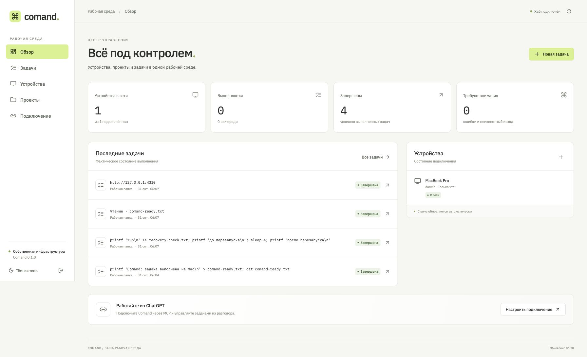

# comand.

[](https://github.com/IMONsergey/comand/actions/workflows/ci.yml)

**Свои компьютеры, проекты и задачи — из одного интерфейса и AI-чата.**

Comand — самостоятельный сервер и агент для macOS/Linux. Сервер хранит задачи и контекст проектов, агент выполняет операции на разрешённом устройстве. Веб-панель и MCP используют один источник состояния. OpenAI API для выполнения команд не нужен.

Это работающая первая версия для одного владельца. Она не зависит от облачного Desktop Commander или Supabase. Закрытый код Remote Desktop Commander не используется.



Снимок работающей установки после проверки команд, восстановления при перезапуске, чтения файла и просмотра страницы. [Мобильный интерфейс в браузерном тесте](docs/images/comand-mobile.png).

## Что работает

- Устройства с одноразовым подключением, статусом и отзывом доступа.
- Проекты: устройство, разрешённая папка, заметки для продолжения работы.
- Команды терминала с тайм-аутом, журналом и остановкой группы процессов.
- Чтение, запись, поиск, список файлов, создание папок и перемещение обычных файлов.
- Условная запись по SHA-256 и создание без перезаписи существующего файла.
- Просмотр HTTP(S)-страницы в отдельном Chromium/Chrome: текст, заголовок и снимок.
- Постоянные задачи с дедупликацией и блокировкой пересекающихся рабочих папок.
- Восстановление результата после разрыва связи и перезапуска сервера/агента.
- Русская адаптивная панель, светлая и тёмная темы, реальные статусы и журналы.
- MCP Streamable HTTP и частный stdio-мост; OAuth с PKCE, обновлением и отзывом доступа.
- Автозапуск через launchd на Mac и systemd user на Linux.

## Быстрый запуск

Нужны **Node.js 24+**, npm и Git. macOS Intel/Apple Silicon и Linux; Windows пока не поддерживается.

```bash
git clone https://github.com/IMONsergey/comand.git
cd comand
npm ci
npm run build
node dist/cli.js init
node dist/cli.js hub
```

Откройте **http://127.0.0.1:4310**. Команда ниже показывает ключ владельца только в вашем терминале:

```bash
node dist/cli.js token
```

Вставьте ключ в форму входа. Ключ хранится в `~/.comand/hub/admin.token` с правами `0600`; приложение не кладёт его в localStorage. Сервер по умолчанию слушает только loopback.

Для другой папки состояния передавайте один и тот же `--data-dir /absolute/path` командам `init`, `hub`, `token` и `service`.

## Подключить компьютер

1. В панели откройте **Устройства → Подключить устройство**.
2. Укажите имя, локальную рабочую папку, папку состояния агента и необходимые возможности.
3. Создайте одноразовый код. Он действует 10 минут и используется один раз.
4. На подключаемом компьютере установите этот репозиторий и выполните выданную команду. Пример:

```bash
mkdir -p "$HOME/Projects/comand-workspace"
node dist/agent/cli.js pair \
  --url http://127.0.0.1:4310 \
  --code ONE_TIME_CODE \
  --name "My Mac" \
  --root "$HOME/Projects/comand-workspace" \
  --allow-shell \
  --allow-browser
node dist/agent/cli.js run
```

`127.0.0.1` работает, когда сервер и агент находятся на одном компьютере. Для другого компьютера используйте **HTTPS-адрес сервера**; открытый HTTP вне loopback отклоняется. Несколько разрешённых папок задаются повторением `--root`.

Потом создайте **Проект** с существующей папкой внутри разрешённых границ и запустите первую задачу, например `pwd` или `git status --short`. В панели доступны её состояние, результат и журнал.

`--allow-shell` разрешает выполнение с правами пользователя ОС. Границы файлового API не ограничивают произвольный shell: это инструмент доверенного владельца, не песочница. Для изоляции используйте отдельную учётную запись, контейнер или виртуальную машину.

### Браузер

Для изолированного просмотра страниц установите Chromium:

```bash
npx playwright install chromium
```

Если комплектный браузер отсутствует, агент может использовать установленный Google Chrome на Mac/Linux. Для явного выбора задайте `COMAND_BROWSER_CHANNEL=chrome` перед запуском агента. Каждая проверка использует отдельный временный профиль; личные вкладки и авторизация пользователя не используются.

## Автозапуск

После инициализации сервера и подключения агента:

```bash
node dist/cli.js service install --kind hub
node dist/cli.js service install --kind agent
node dist/cli.js service status --kind hub
node dist/cli.js service status --kind agent
```

`service restart` перезапускает выбранную службу. `service uninstall` удаляет только службу, сохраняя данные. Для просмотра конфигурации без установки используйте `--print`.

Перед установкой службы остановите экземпляр, запущенный вручную. Настройки сервера хранятся в `hub.json`: команда `init` сохраняет `--host`, `--port`, `--public-url` и соответствующие переменные `COMAND_HOST`, `COMAND_PORT`, `COMAND_PUBLIC_URL`. Успешный запуск `hub` также сохраняет фактически выбранные настройки для следующего запуска службы. Меняйте их через `init`, затем перезапускайте службу.

Явный выбор браузера сохраняется при установке службы агента:

```bash
COMAND_BROWSER_CHANNEL=chrome node dist/cli.js service install --kind agent
```

После изменения этого выбора повторите установку службы агента и выполните `node dist/cli.js service restart --kind agent`. Произвольные переменные окружения терминала служба не сохраняет.

На Linux нужен действующий пользовательский systemd. Для работы после выхода пользователя администратор может включить linger: `sudo loginctl enable-linger USERNAME`. Не запускайте агент от root только ради удобства.

На Mac служба работает в пользовательской GUI-сессии. Спящий или выключенный компьютер не может выполнять новые задачи.

## Подключение к ChatGPT и другим MCP-клиентам

### Публичный HTTPS-сервер

Разверните сервер за TLS reverse proxy и задайте его внешний адрес:

```bash
node dist/cli.js init \
  --host 127.0.0.1 \
  --port 4310 \
  --public-url https://comand.example.com
node dist/cli.js service install --kind hub
```

Для проверки в терминале вместо установки службы запустите `node dist/cli.js hub`. Используйте одинаковый `--data-dir` при инициализации и управлении службой, если папка отличается от стандартной.

В ChatGPT добавьте пользовательский MCP-сервер с URL **`https://comand.example.com/mcp`** и OAuth. Приложение покажет страницу разрешений Comand; подтвердите подключение ключом владельца или действующей сессией. Доступ затем можно отозвать в **Подключение → Подключённые приложения**.

Команды сервера сами не регистрируют интеграцию в аккаунте ChatGPT. Доступность пользовательских MCP и права рабочего пространства проверяются в целевом аккаунте.

### Частный stdio-мост

Для локального MCP-клиента или поддерживаемого защищённого туннеля:

```json
{
  "mcpServers": {
    "comand": {
      "command": "/absolute/path/to/node",
      "args": [
        "/absolute/path/to/comand/dist/cli.js",
        "mcp",
        "--url",
        "http://127.0.0.1:4310",
        "--token-file",
        "/absolute/path/to/hub/admin.token"
      ]
    }
  }
}
```

Токен остаётся в локальном файле. stdout содержит только MCP. Такой stdio-процесс можно предоставить поддерживаемому [Secure MCP Tunnel](https://developers.openai.com/api/docs/guides/secure-mcp-tunnels); настройка самого туннеля и его прав выполняется отдельно по официальной инструкции.

Полный перечень инструментов и семантика задач: [docs/MCP.md](docs/MCP.md).

## Развёртывание и обновление

Для отдельного сервера подготовлены [Dockerfile](Dockerfile), [deploy/compose.yml](deploy/compose.yml), [deploy/Caddyfile](deploy/Caddyfile) и [пример Nginx](deploy/nginx.conf.example). Не подменяйте существующие конфигурации сайтов: добавляйте отдельный виртуальный хост.

Обычное обновление: `git pull --ff-only`, `npm ci`, `npm run build`, затем `service restart` для соответствующих служб. Перед обновлением сохраните папки состояния и завершите текущие задачи; не удаляйте локальные доказательства исполнения. Инструкции: [docs/OPERATIONS.md](docs/OPERATIONS.md).

## Проверки разработки

```bash
npm ci
npm run verify
npm audit --audit-level=high
npx playwright install chromium
npm run test:e2e
```

На компьютере с установленным Chrome: `COMAND_E2E_CHANNEL=chrome npm run test:e2e`.

Основные тесты используют настоящие HTTP-серверы, SQLite, временные папки и дочерние процессы. Сквозной тест останавливает агент, перезапускает сервер и проверяет, что команда выполнилась один раз, а результат и русскоязычные логи восстановились.

Для исходной проверки версии **0.1.0** подтверждены 40 основных тестов на Linux, 39 и один платформенный пропуск на macOS, обе проверки TypeScript, сборка и все четыре браузерных сценария на большом и мобильном экране. Полный браузерный набор также прошёл в установленном Chrome на Mac. Реальные службы macOS/Linux прошли проверку перезапуска во время выполнения команды. Результаты, проверенная ревизия и границы проверки: [docs/VERIFICATION.md](docs/VERIFICATION.md).

При подготовке публичного сервера добавлены четыре регрессии: доверие только непосредственному локальному прокси, раздельные ограничения запросов для его клиентов и привязка сохранённых OAuth refresh tokens к прежнему resource после смены origin. Локальный `npm run verify` прошёл **44/44 теста**, проверки TypeScript и сборку. Это отдельный этап после исходной проверки; прежний успешный CI не объявляется проверкой новых изменений.

Текущие проверенные установки используют отдельные локальные серверы. Для общего сервера выбран `comand.imon.world`, подготовлен Nginx HTTP bootstrap; DNS-запись, сертификат, переключение устройств и регистрация в ChatGPT ещё не подтверждены. Точный статус и порядок развёртывания: [docs/PUBLIC_DEPLOYMENT.md](docs/PUBLIC_DEPLOYMENT.md). Успешные тесты протокола не означают, что подключение в аккаунте уже выполнено.

## Практические границы первой версии

- Один доверенный владелец; нет ролей команды и многопользовательской изоляции.
- Это исполнитель задач. Самостоятельный LLM-агент, бесконечный контекст, управление всеми нативными окнами и отдельный редактор Figma не входят в эту версию.
- Браузерный модуль делает просмотр страницы и снимок; он не управляет личным браузером.
- Принятые команды автоматически не повторяются. Если исход неизвестен, задача получает `uncertain` и удерживает блокировку до проверки владельцем.
- Перезапуск агента/сервера переживается; отказ самого supervisor или компьютера не превращается в выдуманный успех.
- Файловые операции ограничены проектом, но не защищают от враждебного локального процесса, одновременно меняющего файловую систему.
- Перемещение без перезаписи поддерживается для обычных файлов в одной файловой системе. Для каталогов используйте явно разрешённую команду.
- Журнал ограничен 10 MiB на задачу; превышение отмечается. История и результаты не удаляются автоматически. Планируйте дисковое пространство и резервные копии.
- После перезапуска сервера веб-сессия требует повторного входа; устройства и OAuth-подключения сохраняются.

Архитектура: [дизайн](docs/superpowers/specs/2026-10-31-comand-design.md). Границы доверия: [SECURITY.md](SECURITY.md).
